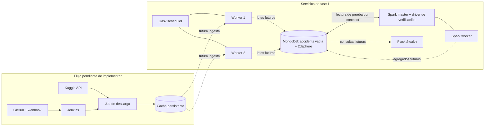

# Arquitectura de fase 1

La infraestructura se ejecuta en un único Docker Desktop Linux bajo WSL2. Se mantienen los procesos distribuidos reales exigidos por el profesor, aunque compartan hardware. Los contenedores tienen límites de memoria y CPU; no se presenta esta topología como tolerante a fallos ni como un clúster de varios equipos físicos.

Jenkins ya es un servicio real; se ubica junto al flujo futuro en el diagrama para distinguir las automatizaciones todavía pendientes. La API no consulta MongoDB en su endpoint de salud.

| Componente | Versión seleccionada | Decisión |
|---|---|---|
| Python local | 3.10.11 instalado | `.venv` aislado; no utilizar 3.14 global |
| Python API/Dask | 3.10.20 slim Bookworm | Misma versión menor local; imágenes por digest |
| Flask / Gunicorn | 3.1.3 / 23.0.0 | Factoría, servidor Linux con un proceso y dos hilos |
| pytest | 8.4.2 | Pruebas locales y en imagen test |
| MongoDB | 8.0.16 | Autenticación; caché WiredTiger 0,25 GiB; sin puerto al host |
| Spark | 3.5.8, Scala 2.12, Java 17, Python 3.10.12 | Imagen oficial; misma versión menor de Python que API/Dask; no usar Spark 4 con este conector |
| MongoDB Spark Connector | 10.7.0 | Compatible con Spark 3.2–3.5 y MongoDB ≥4.2 |
| Java MongoDB driver | 5.1.4 | Dentro de rango `[5.1.1,5.1.99)` declarado en POM del conector |
| Dask / distributed | 2025.5.1 ambos | Compatibles con Python 3.10; misma imagen scheduler/workers |
| Pandas / PyArrow | Ver requirements/dask.txt | Resolución transitiva fijada, sin instalar motores en Windows |
| PyMongo | 4.15.1 | Preparado para carga futura desde Dask |
| Jenkins | 2.568.3, JDK 21 | LTS fijado; asistente y autenticación conservados |
| Docker CLI en Jenkins | 29.5.3 | Cliente del mismo motor local, Compose incluido |

Las bases se fijan por digest de índice multi-arquitectura y versión legible. Las versiones Maven se descargan durante el build y se comprueba el checksum publicado por Maven Central. No se descargan JAR en cada ejecución ni se resuelven versiones dinámicas del conector. No es una garantía de compilación idéntica bit a bit, pues intervienen metadatos de compilación y servicios de distribución; sí evita cambios silenciosos de versión en las dependencias de ejecución fijadas.

## Redes y almacenamiento

`backend` es una red interna de Compose con DNS por servicio: MongoDB, Dask, Spark y API. MongoDB y RPC de los motores no publican puertos. La red `frontend` conecta además API, Spark master y Dask scheduler para que Docker publique sus puertos en loopback; esos tres contenedores tienen salida, mientras MongoDB y los workers permanecen únicamente en `backend`. Esta separación resolvió una restricción observada de publicación en redes exclusivamente internas de Docker Desktop. `ci` permite salida de Jenkins para plugins, GitHub y futuras descargas. Jenkins opera Docker por socket, sin necesitar acceso directo a la base ni conocer las credenciales de la aplicación en esta fase.

| Volumen | Contenido | Persistencia |
|---|---|---|
| mongo_data / mongo_config | Datos, índices y configuración MongoDB | Conservar |
| jenkins_home | Usuarios, plugins, jobs y credenciales Jenkins | Conservar |
| dataset_cache | Futuro ZIP/CSV, manifiestos, muestras reproducibles | Preparado, vacío |
| dask_worker_1_scratch / dask_worker_2_scratch | Derrame a disco | Reutilizable; no es fuente de datos |
| spark_master_scratch / spark_worker_scratch | Archivos temporales Spark | Reutilizable; no es fuente de datos |

El volumen de dataset es compartido solo donde se necesita; no se hace pasar `.venv`, repositorio ni `Insumos` como volumen de ejecución. En el pipeline futuro, la caché necesitará locks y manifiestos atómicos para evitar repetir descargas o aceptar procesos incompletos. Estas reglas aún no están implementadas.

Las imágenes Dask y Spark inicializan `/data` con grupo 0 y modo `2775`; sus procesos se ejecutan sin ser root y comparten ese grupo. Así, un volumen nuevo es escribible independientemente de qué imagen lo inicialice primero. `verify_infra.py` comprueba el permiso desde ambos workers. El futuro contenedor de descarga deberá respetar este grupo y no montar credenciales dentro de la caché.

MongoDB tiene usuario administrador para inicialización y usuario `accidents_app` con `readWrite` únicamente sobre `us_accidents`. Las contraseñas aleatorias se guardan en `.env` ignorado. El campo geoespacial será `location: {type: 'Point', coordinates: [longitud, latitud]}`. El esquema exige dos números; el índice verifica la geometría y límites geográficos. La futura limpieza Dask descartará previamente nulos, infinitos y valores fuera de rango y conservará un identificador determinista del accidente.

## Presupuesto de recursos

| Servicio | Límite contenedor | CPU máxima |
|---|---:|---:|
| MongoDB | 768 MiB | 1 |
| Spark master y eventual driver de prueba | 1024 MiB | 1 |
| Spark worker | 1536 MiB | 1 |
| Dask scheduler | 384 MiB | 0,5 |
| Cada worker Dask (dos) | 1024 MiB | 1 |
| Flask | 256 MiB | 0,5 |
| Jenkins | 1024 MiB | 1 |
| Total servicios permanentes | 7040 MiB = 6,875 GiB | 7 |

Docker Desktop dispone de aproximadamente 7,64 GiB en este equipo. Los límites no son reservas; el consumo real en reposo y las pruebas consta en el informe. La construcción de imágenes, el contenedor de pruebas (256 MiB) y procesos del motor quedan fuera del total. No ejecutar ETL Dask y Spark simultáneamente en fases futuras; medir y ajustar cuando exista carga real. La primera fase no prueba el rendimiento con un millón de filas.

Dask: un proceso por worker y un hilo; memoria de proceso 768 MiB, derrame desde 70 %, pausa desde 80 % y reinicio desde 95 %. Spark: un core para el worker y el ejecutor, ejecutor 768 MiB, driver 512 MiB y cuatro particiones shuffle. El driver se ejecuta en `spark-master` durante el smoke; al crear jobs nuevos habrá que respetar esa ubicación o redefinir `spark.driver.host` y sus puertos.

## Integración continua preparada

El arranque CMD exige pytest antes de `compose up`. El Jenkinsfile inicial exige pytest antes de construir la candidata; no tiene una etapa de despliegue activada. En la próxima fase, se deberá añadir entorno candidato, smoke HTTP previo a promoción, etiquetado de imagen inmutable y política de recuperación de un despliegue fallido. Nunca desplegar desde `post { always }` ni ignorar códigos de salida. El pipeline completo todavía no ha sido ejecutado.

## Fuentes técnicas consultadas

- [Compatibilidad oficial del MongoDB Spark Connector](https://www.mongodb.com/docs/spark-connector/v10.x/).
- [POM del conector 10.7.0 en Maven Central](https://repo.maven.apache.org/maven2/org/mongodb/spark/mongo-spark-connector_2.12/10.7.0/mongo-spark-connector_2.12-10.7.0.pom).
- [Instalación y Java admitido por Spark 3.5.8](https://spark.apache.org/docs/3.5.8/api/python/getting_started/install.html).
- [Administración de memoria de workers Dask](https://distributed.dask.org/en/stable/worker-memory.html).
- [CLI Dask para scheduler y workers](https://docs.dask.org/en/stable/deploying-cli.html).
- [Índices 2dsphere y orden de coordenadas](https://www.mongodb.com/docs/manual/core/indexes/index-types/geospatial/2dsphere/).
- [Jenkins en Docker](https://www.jenkins.io/doc/book/installing/docker/).

Las etiquetas y digests de imágenes se comprobaron directamente contra el registro Docker. Las dependencias se resolvieron e instalaron realmente; la compatibilidad operativa debe distinguirse de la sola compatibilidad documentada, según las pruebas del informe.
